# Screenshots

<!-- Generated by tests/screenshot-gallery.spec.ts. Run `npm run test:screenshots:update` to refresh it. -->

Every login page the `nebari` theme renders, in light and dark mode. These are the baselines the
[screenshot tests](development.md#screenshot-tests) compare against on every pull request, so they show
what `main` renders. The consoles are not covered; see [What CI checks](development.md#what-ci-checks).

## Full page

| Light | Dark |
| --- | --- |
|  | 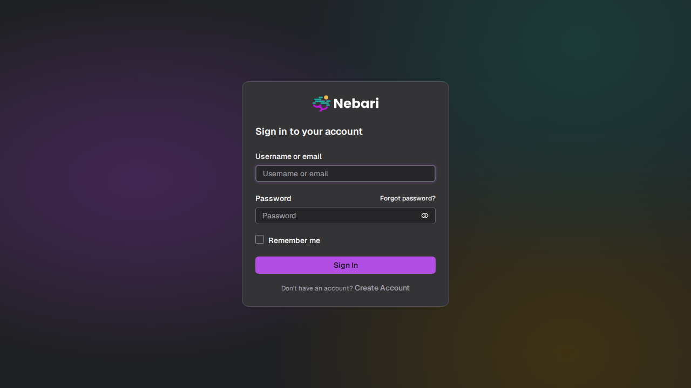 |

## Login pages

Each capture is cropped to the card. The page name is the `?preview=` value that renders it in the dev server.

| Page | Light | Dark |
| --- | --- | --- |
| `error` | 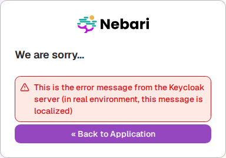 | 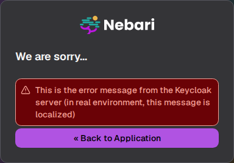 |
| `forgot-password` | 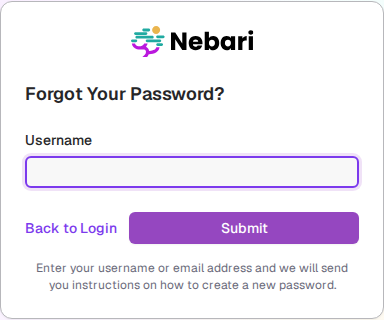 | 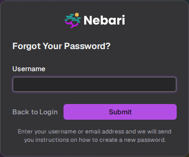 |
| `info` | 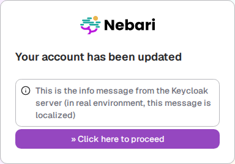 | 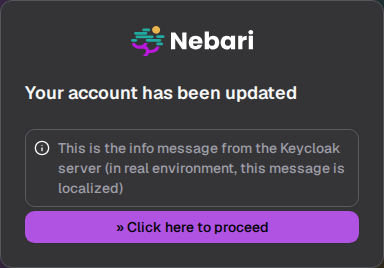 |
| `login` | 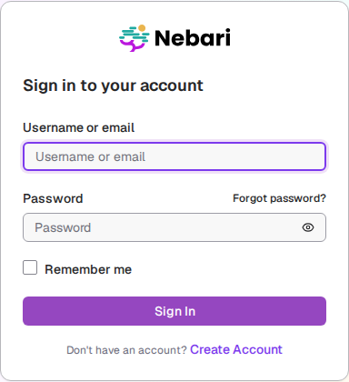 | 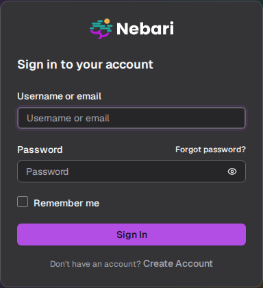 |
| `login-error` | 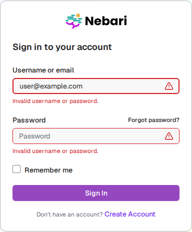 | 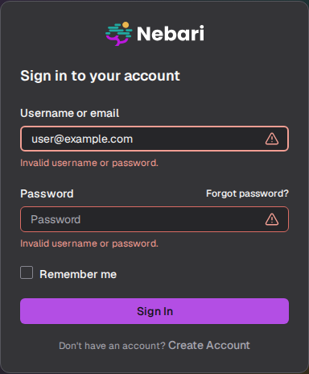 |
| `login-providers` |  | 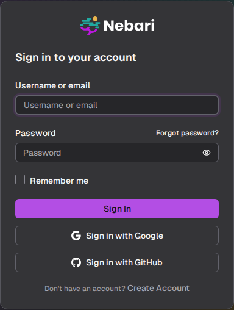 |
| `register` | 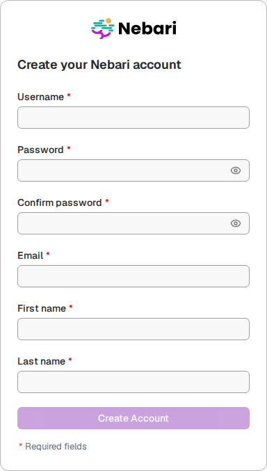 | 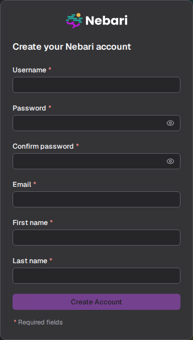 |
| `update-password` | 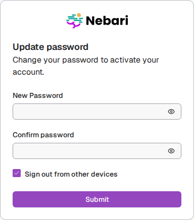 | 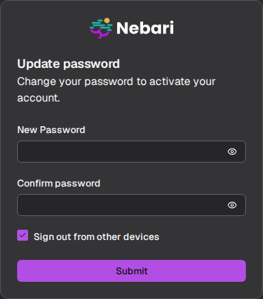 |
| `update-profile` | 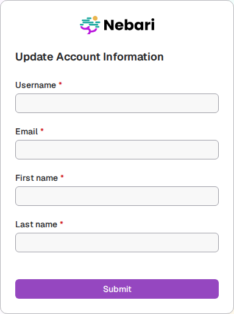 | 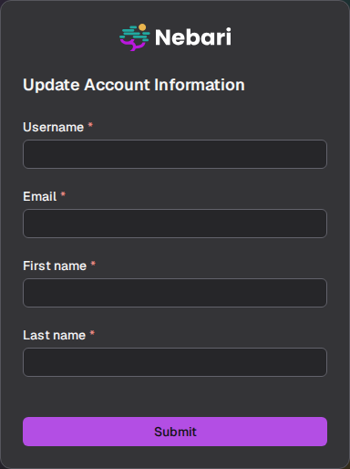 |
| `verify-email` | 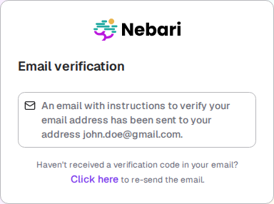 | 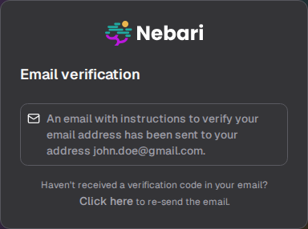 |
