# Theme customization

The Admin Console carries a **Theme customization** page (sidebar: *Configure &rarr; Theme customization*,
route `#/<realm>/branding`) where a realm admin with `manage-realm` can rebrand the login pages without
rebuilding the theme: company name, light and dark logos and backgrounds, palettes, card radius, colour
scheme, which login methods are shown, and advanced settings such as the font, button shape and a wordmark.
Changes are previewed before they are published, and a theme can be exported to and imported from JSON.

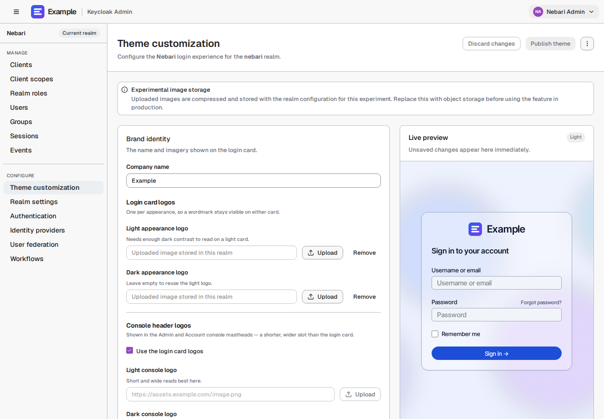

The images on this page show a made-up brand, "Example". How they are produced and kept current is in
[Development](development.md#screenshot-tests).

For changes beyond what the editor offers (a brand's own CSS, logo files or login wording), build a child theme
in its own repository instead; see [Child themes](child-themes.md).

This page has two halves. [Using the editor](#using-the-editor), [Keeping and moving a
theme](#keeping-and-moving-a-theme) and [Operating it](#operating-it) are for realm admins and the people who
deploy Keycloak. [For theme developers](#for-theme-developers) covers how it works, for anyone changing this
repository.

## Using the editor

Both themes, `nebari` and the unbranded `template`, carry the page in their Admin Console. A deployment can turn
it off; see [Turning the Theme customization page off](#turning-the-theme-customization-page-off).

### The settings

The settings are grouped into cards:

| Brand identity | Color palette | Layout |
| --- | --- | --- |
| 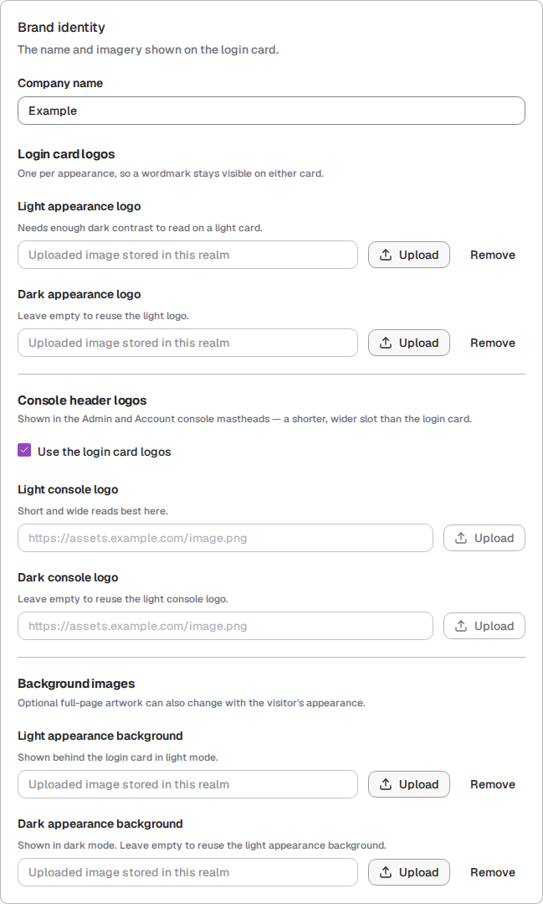 | 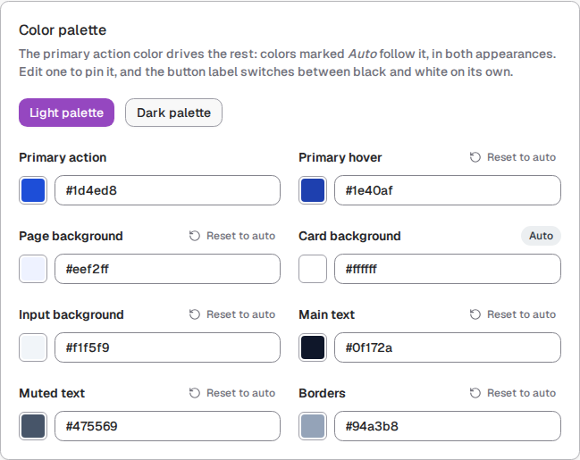 | 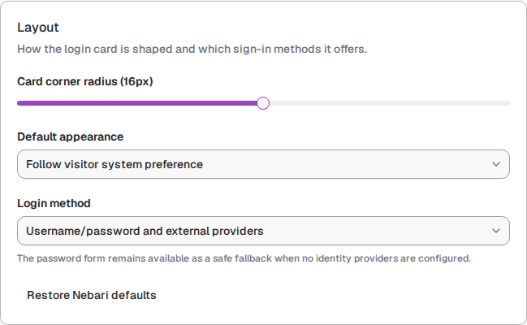 |
| Company name; login card, console header and background artwork, each with a light and a dark variant | The eight palette roles, set separately for light and dark | Card corner radius, the default appearance (light, dark or the visitor's system setting) and which login methods are shown |

A fourth card, [Advanced settings](#advanced-settings), is collapsed under *Layout*.

### Preview, publish and discard

The **Live preview** beside the cards renders the draft with the same components as the login page, in
whichever palette the Color palette card's **Light palette** / **Dark palette** switch is editing. **Publish
theme** writes the draft to the realm, and the login pages use it from their next load. **Discard changes**
returns to what is published.

| Live preview | Published, light | Published, dark |
| --- | --- | --- |
| 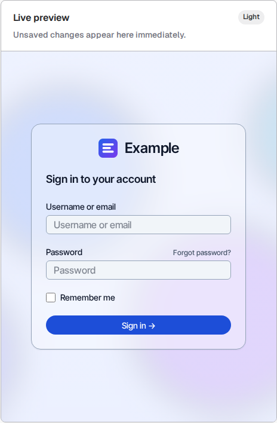 | 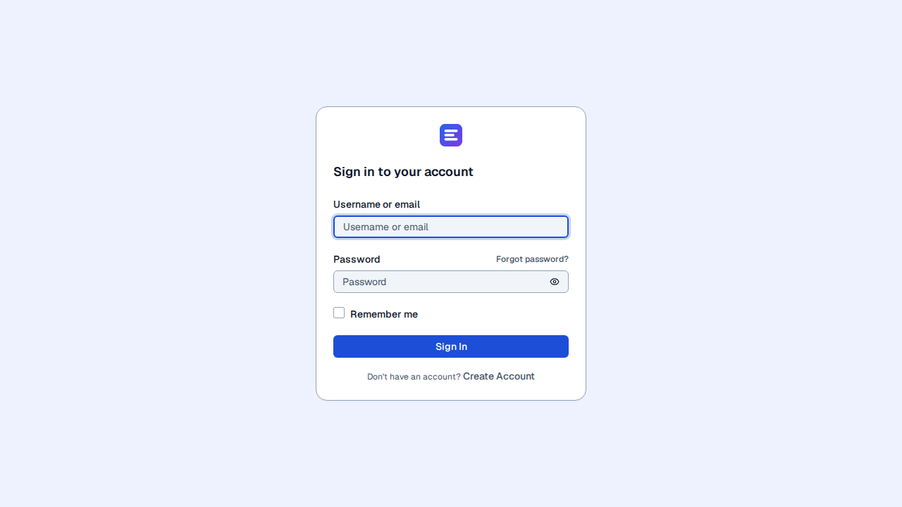 | 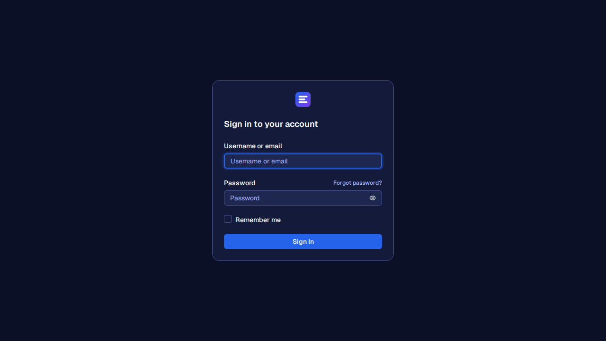 |

### Images

Every image field takes either an upload or a hosted URL. Hosted URLs are used as supplied and must be HTTPS.
Uploaded PNG, JPEG and WebP files, up to 5 MB, open in a crop editor before they enter the draft. It supports
pointer dragging, keyboard positioning and 100 to 300% zoom. Applying the crop converts the selection to WebP
and bounds it by kind:

| Kind | Crop frames | Largest size | Stored size |
| --- | --- | --- | --- |
| Logo (login card and console header) | Original, wordmark, square, landscape | 640 x 240 | 160 KB |
| Background | Original, landscape, standard, square | 1600 x 1000 | 420 KB |
| Icon (browser icon and Admin welcome mark) | Square only | 256 x 256 | 48 KB |

Logos use a smaller budget than backgrounds because two may be stored alongside them. SVG, `http:` URLs and
anything else are dropped during validation.

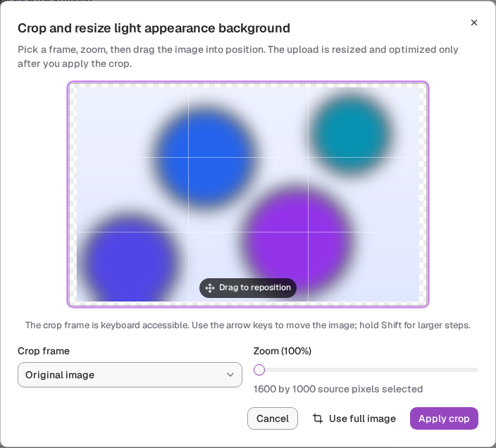

Each logo and background has **Light appearance** and **Dark appearance** values. An empty variant falls back to
its sibling, so a deployment can upload one universal asset or a contrast-safe pair. The editor preview and
both login themes resolve the same fallback, so a white wordmark doesn't disappear on a light card, without
requiring every realm to upload two files.

A background image is drawn under the palette's page background at 85% opacity, so the card and its text stay
readable over any image. Only bold shapes and colours show through; a subtle image barely shows at all. The
images under [Advanced settings](#advanced-settings) show a background in use.

### Login method presentation

**Login method presentation** decides whether the password form is shown alongside the identity providers or
only the providers:

| Password and providers (default) | Providers only |
| --- | --- |
| 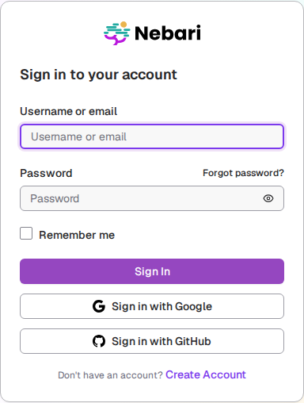 | 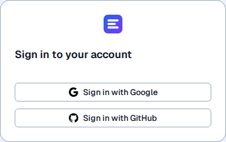 |

### Advanced settings

A collapsed **Advanced settings** card under *Layout* covers what a brand needs beyond colours and artwork. Every
field lives in `BrandingConfig.advanced` and goes through `normalizeAdvanced` in
[`src/branding/brandingConfig.ts`](../src/branding/brandingConfig.ts):

| Setting | Accepted values | Applies to |
| --- | --- | --- |
| Font | `theme`, `inter-tight`, `dm-sans`, `system` | Both login themes |
| Card opacity, blur | 5 to 100 %, 0 to 40 px | Both login themes |
| Logo height | 24 to 96 px, or the theme's own size (the default: a 32 px-tall box on `nebari`, 40 px on `template`). The width follows the image, and a wordmark scales with it | Login card, both login themes. The console headers keep their own size |
| Button shape | `theme`, `rounded`, `pill`, `square` | Both login themes |
| Arrow on the sign-in button | on or off | Both login themes |
| Wordmark | Plain text, up to 40 characters | Login card, both console mastheads |
| Register page title | Plain text, up to 80 characters; empty keeps the theme's | Both login themes |
| Browser icon | HTTPS URL or PNG/JPEG/WebP data URI, up to 100 KB | Login pages, both consoles |
| Admin welcome mark | Same as the browser icon | Admin Console welcome tab |

The defaults reproduce the theme exactly, so a realm that never opens the card stays unbranded. Why there is no
free-form CSS field is covered under [Security model](#security-model).

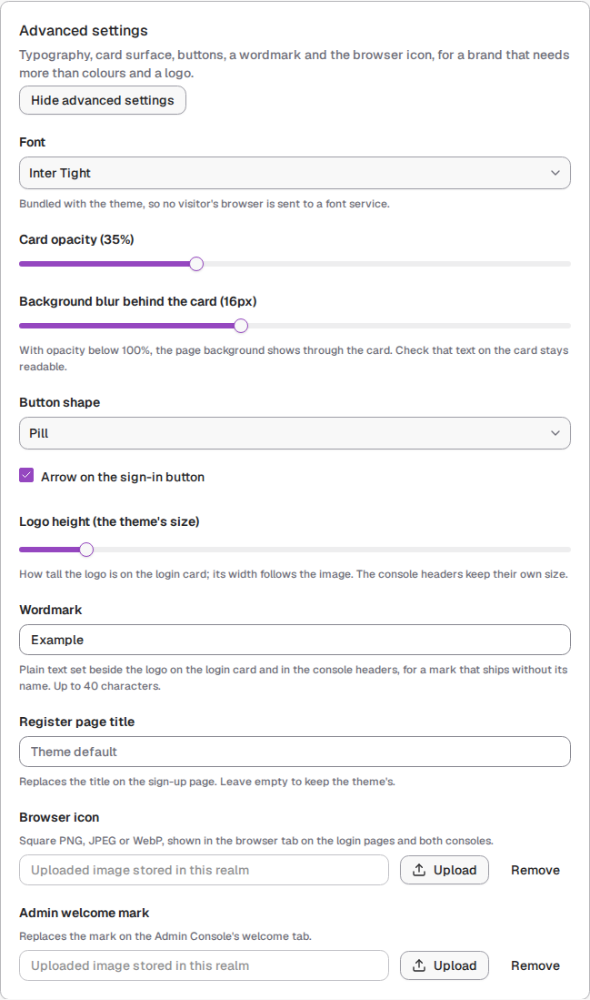

The same palette, logo and background image, before and after the settings in that card (Inter Tight, a 35%
card with a 16 px blur, pill buttons with an arrow, and the wordmark "Example"):

| Advanced settings at their defaults | Advanced settings applied |
| --- | --- |
| 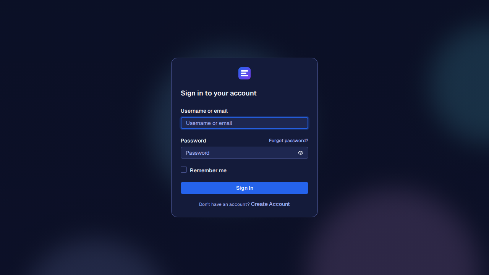 | 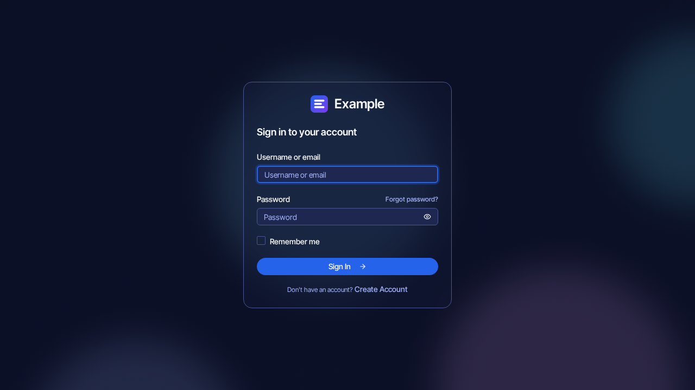 |

Button shapes and the arrow, on the `nebari` theme. **Theme** keeps the login theme's own radius, which for
`nebari` is close to **Rounded**:

| Theme | Rounded | Pill | Square | Theme, with arrow |
| --- | --- | --- | --- | --- |
|  |  |  |  |  |

A wide logo, here 3.2:1, in the theme's own box and at a 56 px logo height:

| The theme's size | 56 px |
| --- | --- |
| 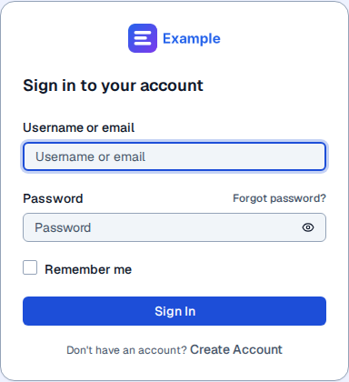 | 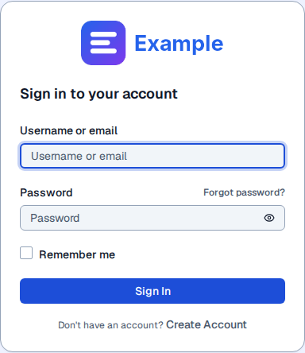 |

The settings apply to both login themes. The same config on `template`:

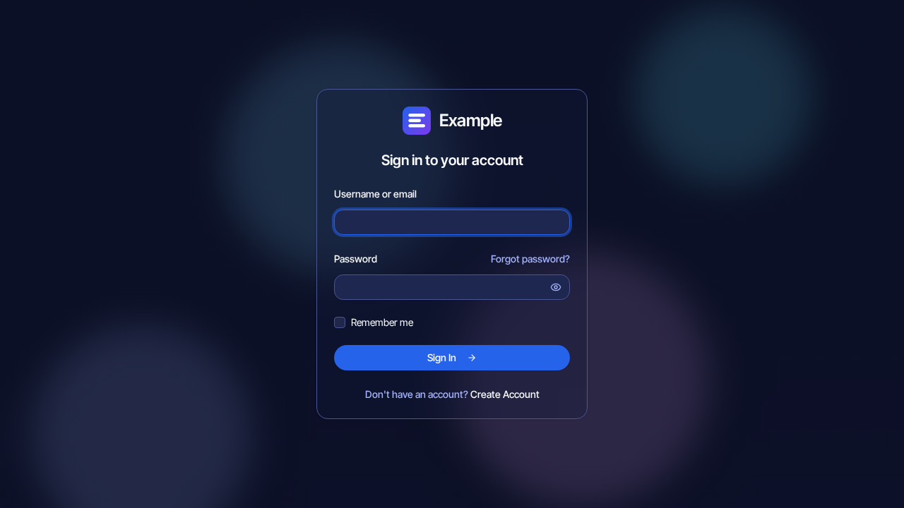

### Console logos

The Admin and Account console mastheads show the realm's logo too. The **Console header logos** group in Brand
identity has its own light and dark artwork plus a **Use the login card logos** checkbox, on by default, so one
mark can serve both surfaces. Turn it off and give the console its own artwork when a login-card mark looks
cramped in the 32px-tall masthead. The masthead in the image at the top of this page reuses the login card's
"Example" logo, with its wordmark beside it.

The consoles take nothing else from the editor: their colours are the same for every theme (see
[Known gaps](#known-gaps)).

## Keeping and moving a theme

### Where a published theme lives

Publishing writes the config into the realm's **localization messages**, under the `nebariBrandingConfig` key,
so it lives in Keycloak's database. That has one consequence worth knowing before relying on it:

| | |
|---|---|
| Container restart | **Survives**: the data is in the Postgres volume |
| Fresh database / new deployment | **Lost**, unless the deployment seeds it (below) |
| In the theme JAR or the repo | **No** |

### Seeding a preset so a realm starts branded

A deployment can put a preset into the realm itself, so a fresh database comes up
branded with nobody opening the editor. The value is the preset's `config` object,
base64-encoded behind a `base64:` prefix, which is the same format **Publish** writes:

```bash
VALUE="base64:$(jq -c .config my-preset.json | base64 -w0)"
```

It goes under the `nebariBrandingConfig` key of the realm's localization texts,
in every locale the realm supports plus `en`.

**A new realm**, created from a realm JSON (`kcadm.sh create realms -f`, or
Keycloak's `--import-realm` at startup):

```json
{
  "realm": "my-realm",
  "loginTheme": "nebari",
  "accountTheme": "nebari",
  "adminTheme": "nebari",
  "localizationTexts": {
    "en": { "nebariBrandingConfig": "base64:..." }
  }
}
```

**An existing realm**, one call per locale. `--import-realm` skips realms that
already exist, so this is the route for them:

```bash
jq -n --arg v "$VALUE" '{nebariBrandingConfig: $v}' > branding.json
kcadm.sh create realms/my-realm/localization/en -f branding.json
```

Both were checked on Keycloak 26.8 deployed by Nebari Infrastructure Core, with a
54 KB preset that embeds its images. The login page and both consoles render the
preset on first load. The editor opens the realm with the preset as its published
state, with nothing pending to publish. A Keycloak restart keeps it.

The value is validated when it is read, like a published one, so a bad seed falls
back to the theme's defaults rather than breaking the page.

### Exporting and importing

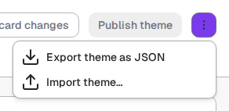

**Theme options &rarr; Export theme as JSON** saves the draft as a preset file: to keep a copy, to move a theme
to another realm or deployment, or to seed it as above. Where the file lands is the browser's decision.
Chromium exposes `showSaveFilePicker`, which lets the admin choose a folder and remembers it for next time;
Firefox and Safari fall back to an ordinary download.

**Theme options &rarr; Import theme...** offers the presets this theme ships (each theme's defaults, from
[`custom_themes/`](../custom_themes/README.md)) alongside a file picker, and previews the selected theme with the
same preview the editor uses before anything is applied. Importing replaces the *draft* only; publishing stays a
separate step, so an import can still be discarded.

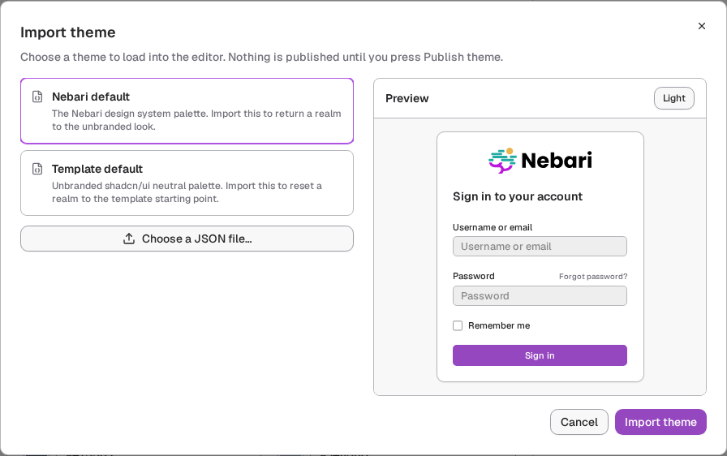

A deployment's own brand is kept as such a file in the deployment's own repository, not in this one. For
example, the OpenTeams Collab look, which was part of this repository before 2.0.0, is available as a preset in
[a comment on the first pull request to remove it](https://github.com/nebari-dev/nebari-keycloak-theme/pull/49#issuecomment-6243889566).

Imported JSON is untrusted and always goes through `normalizeBrandingConfig`, the same validator the published
config passes through. `BrandingConfig` version 2 stores `logo` and `backgroundImage` as `{ light, dark }` image
sets. Version 1 imports and already-published realm values remain supported: their single string is expanded to
both appearances during normalization, so upgrading does not change what users see. The next publish or export
writes the normalized version 2 shape. Fields a file leaves out, such as the advanced settings in an older
export, take the defaults.

### It is stored once per locale, and the copies can disagree

A localization message belongs to a locale, so the config is written under every
locale the realm supports plus `en`. That is
[`src/branding/localeVariants.ts`](../src/branding/localeVariants.ts), and four
hazards follow from it, all covered by
[`tests/localeVariants.spec.ts`](../tests/localeVariants.spec.ts):

- **Never trust the default locale alone.** Change a realm's default locale to
  one that was never published to and it reads empty. Treating that as the truth
  would show the editor a set of theme defaults indistinguishable from an
  unbranded realm, and the next publish would write those defaults over the real
  config in every other locale. So the editor reads *all* locales first and a
  populated value always outranks an empty one.
- **Two populated values that disagree are not a guess.** The editor refuses to
  open and asks which to keep, previewing each, because either answer discards a
  theme somebody published.
- **Publishing is also the repair.** A locale added after the last publish, or a
  publish that failed part way, leaves locales behind while the draft still
  equals the published config, so Publish is enabled whenever locales are out
  of sync, not only when the draft is dirty. There is no multi-locale write to
  make it atomic; the writes are sequential, failures are reported per locale,
  and retrying is idempotent.
- **A locale that could not be read is not an empty locale.** They mean opposite
  things: nothing was published there, versus it may hold anything, including
  the realm's only copy. `readLocaleVariants` therefore reports failed reads
  separately, and finding no theme while some locale was unreadable is treated
  as *unknown*, not unbranded: the editor stays closed, exactly as for a failed
  load. Folding the two together is what would let a transient outage present
  as an unbranded realm and invite an overwrite.

## Operating it

### Turning the Theme customization page off

Not every deployment wants the editor. Two layers decide, in
[`src/admin/themeCustomization.ts`](../src/admin/themeCustomization.ts):

| | Where | Effect |
| --- | --- | --- |
| Per theme | `themeCustomization` in `THEME_CATALOG` | Baked into that theme's `theme.properties` at build time. Because each theme is packaged into its own JAR, a theme with no use for the editor ships without it. Both shipped themes enable it. |
| Per deployment | `NEBARI_THEME_CUSTOMIZATION=enabled\|disabled` | An environment variable on the Keycloak container, resolved by Keycloak when it renders the page. Overrides the theme. No rebuild, no realm change. |

Dropping the route in [`src/admin/routes.tsx`](../src/admin/routes.tsx) is the
whole gate: `LeftNav` renders nothing for a path it cannot find among the
routes, so the sidebar entry goes with it, and a hand-typed
`#/<realm>/branding` lands on the not-found page.

This hides the editor rather than revoking anything. The published config lives
in the realm's localization messages, which any holder of `manage-realm` can
still write through the Admin API, and the login pages go on honouring what is
already published. Treat it as a deployment deciding the page is not part of its
product, not as an access control.

Both values arrive as `kcContext.properties`, which is how Keycloak hands
`theme.properties` to the console. Keys beginning with `kc`, plus `locales`,
`import`, `meta` and `accountResourceProvider`, are filtered out of that object
by the generated FTL, so do not name a property `kc*`.

### Security model

The config is written by anyone with `manage-realm`, imported from files of unknown origin, or seeded by a
deployment, and it is rendered to every unauthenticated visitor of the login page. It is therefore untrusted at
every entry point: the editor, an import and a published or seeded value all go through
`normalizeBrandingConfig`, and an invalid value falls back to the theme's defaults rather than reaching the page.

**Why there is no "custom CSS" box.** A free-form field would be a stored injection point on the page that
collects passwords. Every setting is therefore closed vocabulary, and each kind of value has exactly one way
onto the page:

- **Colours** must be `#rrggbb`, and become CSS custom properties.
- **Fonts and shapes** are names from a fixed list. The CSS font stacks are written in the code, never taken from
  the config, and each font is bundled and loaded on demand from the theme, so no visitor is sent to a font service.
- **Numbers** are clamped integers before they become the `--branding-card-opacity` and `--branding-card-blur`
  custom properties.
- **Flags** become fixed data attributes (`data-button-shape`, `data-button-arrow`, `data-card-glass`) that the
  stylesheets key off.
- **Text** is stripped of control characters and bidirectional overrides (so a wordmark cannot display as something
  other than what is stored), capped in length, and rendered only as a React text node. It never goes through the
  HTML message path.
- **Images** must be HTTPS URLs or PNG, JPEG or WebP data URIs, and are only assigned as an `href`, an image
  `src`, or a quoted CSS string.

## For theme developers

### Themes

The build ships two login themes, **each in its own JAR**, selected per realm by
Keycloak's **Login theme** setting:

| Theme | Components | Branding | For |
| --- | --- | --- | --- |
| `template` | stock shadcn/ui (Radix) | none | the default: a starting point to customize |
| `nebari` | Nebari registry (Base UI) | Nebari logo and palette | Nebari's own deployments |

| `template`, unbranded | `nebari` |
| --- | --- |
| 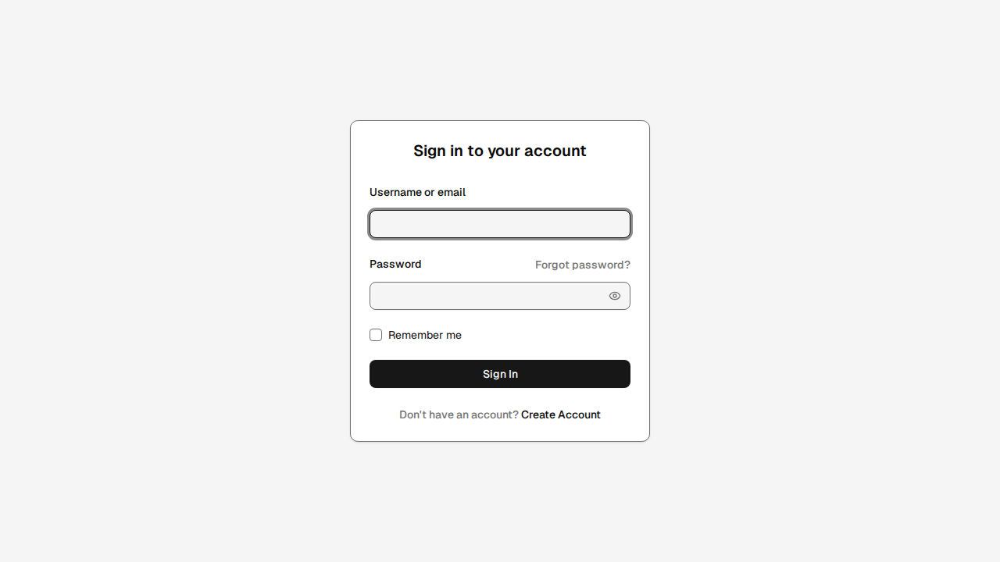 | 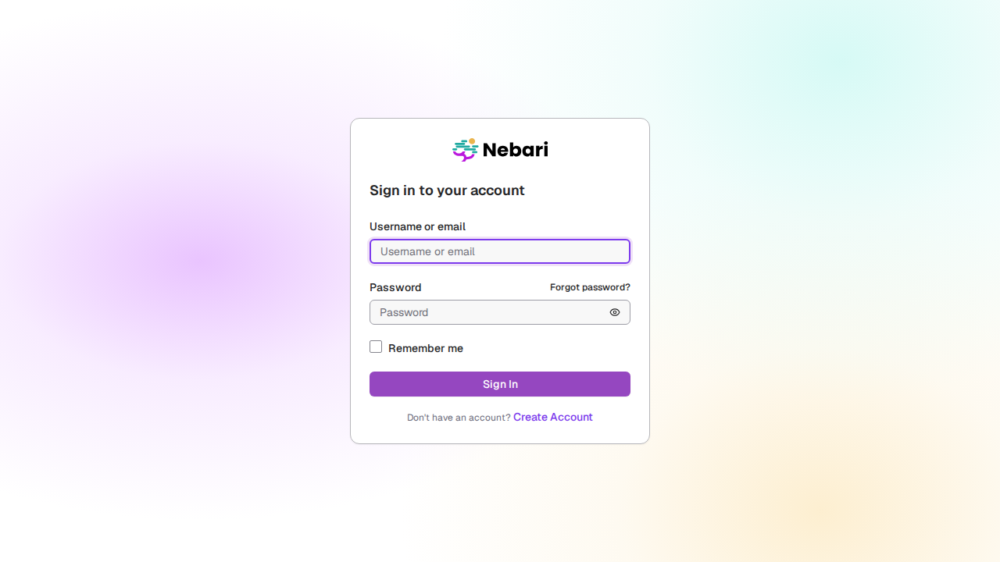 |

### The registry

A theme is registered in exactly two places, and they are checked against each
other rather than left to agree by convention:

- **[`themes.json`](../themes.json)**: the names, in packaging order. Read by
  [`vite.config.ts`](../vite.config.ts) and
  [`scripts/build-keycloak-themes.mjs`](../scripts/build-keycloak-themes.mjs),
  which run in Node and cannot import the app's React-typed modules.
- **`THEME_CATALOG` in
  [`src/themes/themeCatalog.ts`](../src/themes/themeCatalog.ts)**: the metadata,
  keyed by those names. The key *is* the name, so a definition cannot disagree
  with its own identity.

`themeCatalog.ts` derives `CUSTOM_THEME_NAMES` from `themes.json` and throws at
module load if either side has a name the other lacks. A name in `themes.json`
with no catalog entry would package a theme whose login pages silently fall back
to another theme's; a catalog entry missing from `themes.json` would work in dev
and never reach a JAR. Both are quiet failures, so they are made loud.

**Adding a theme** is therefore:

1. Add the name to `themes.json`. Position matters only for the first entry,
   which is the default.
2. Add its entry to `THEME_CATALOG`: `componentSet` picks which login pages it
   renders, `logo` is used by all three consoles, `themeCustomization` decides
   whether its Admin Console carries the editor, `defaultBranding` is its
   palette.
3. Add its pages under `src/login/` if it needs its own, and register the set in
   [`src/login/uiSets.ts`](../src/login/uiSets.ts). A theme that reuses an existing
   component set needs neither.

Nothing else. The build script, the JAR names, the CI release table, the Admin
Console masthead and the theme.properties switches all follow from those two
files.

`template` is the default because it is *first* in `themes.json`:
`DEFAULT_THEME_NAME` is `CUSTOM_THEME_NAMES[0]`, which is also the theme
keycloakify packages as primary. A realm that has not chosen a theme therefore
gets the unbranded one rather than someone else's branding, and the two meanings
of "default" cannot drift apart.

The two are not interchangeable at the component level (Base UI's
`<FieldError match={...}>` has no Radix equivalent), so each owns its own pages.
[`src/login/uiSets.ts`](../src/login/uiSets.ts) picks the whole set once from the
theme name and `KcPage` renders it. Every member is `lazy`, so a realm only
downloads the theme it uses.

### The `template` theme

Deliberately unbranded: no logo, no wordmark, no accent hue. Its palette is
stock shadcn's `neutral` base (Tailwind's `neutral` scale), so the primary is a
near-black in light mode and near-white in dark. A logo appears only once a
deployment uploads one in **Theme customization**, so nothing has to be removed
first.

The neutral starting point is still production-ready rather than a bare
component demo. Page, card and input surfaces are separate; every visible form
control paints `inputBackground`; and the neutral-500 border gives unfocused
controls at least 3:1 non-text contrast against both card and input surfaces in
light and dark mode. Error text uses a mode-specific neutral-theme red with at
least 4.5:1 text contrast. These defaults are browser-tested as well as captured
in the screenshot suite. An admin can deliberately replace any colour in
**Theme customization**, so imported or hand-edited palettes should preserve
the same contrast relationships.

- Shell and pages: [`src/login/template/`](../src/login/template/). Start with
  `Template.tsx`, which owns the background, the card and the logo slot.
- Components: [`src/components/shadcn/`](../src/components/shadcn/), kept separate
  from the Nebari registry in `src/components/ui/` so
  `npx shadcn@latest add <component>` yields matching components.
- Defaults: `TEMPLATE_BRANDING_CONFIG` in
  [`src/branding/brandingConfig.ts`](../src/branding/brandingConfig.ts), mirrored
  for import as `custom_themes/template-default.json`.

Because it is unbranded it cannot reuse the Nebari-branded message overrides in
`src/login/i18n.ts`: custom translations replace a message for every theme in
the build, so neutral wording needs its own key (`templateRegisterTitle`).
Stock shadcn components also assume their initializer's global
`border-border` base rule. This project supplies the equivalent under
`[data-login-theme="template"]` only, so generated Card, Alert and outline
Button borders receive the configured token without leaking into the Nebari
theme or Keycloak consoles. Keep that rule scoped when adding more shadcn
components. The shared shell also supplies the page's `<main>` landmark and
semantic `<h1>`; individual flow pages provide the localized heading text.

### How the consoles pick their logo

The Admin and Account consoles are PatternFly, re-skinned onto the design
system's tokens by the bridge in
[`src/admin/index.css`](../src/admin/index.css). Every theme shares that skin;
what varies per theme is the mark in the masthead, not the palette.

The Admin Console masthead takes the first of:

1. the live preview, while an admin is editing under **Realm settings &rarr; Themes**;
2. `logo` from the theme's `theme.properties`, Keycloak's own hook, so a
   deployment can point at its own file by layering a child theme, with no
   rebuild;
3. **the realm's published console logo**, from **Theme customization**'s
   *Console header logos*, or the login card logos while **Use the login card
   logos** is on. It arrives through the realm's localization messages, which
   the console's i18n already loads before first paint, so it needs no fetch of
   its own and cannot flash;
4. `ThemeDefinition.logo` for the theme Keycloak is rendering, read from the
   same catalog the login pages use. `kcContext.themeName` is injected into
   both consoles, so a theme cannot brand one and not the other;
5. otherwise the realm's display name, as a wordmark.

The Account console has no live preview and does not read `theme.properties`' `logo`, so it uses steps 3 to 5
only. Steps 3 and 4 are resolved by [`src/branding/consoleLogo.ts`](../src/branding/consoleLogo.ts), shared by
both consoles so they cannot disagree.

`useLoginLogoInConsole` defaults to **true**, which is what a realm that
published before the field existed normalizes to, so adding it changed nothing
for existing realms. Turned off, `consoleLogo` is used instead.

Step 5 is why the unbranded `template` theme does not show someone else's logo
in either console.

### How branding reaches the login page

Branding reaches the page as **CSS custom properties**, set inline on the login
wrapper by `getBrandingCssVariables`: `--card`, `--primary`, `--input`,
`--ring` and friends, which the design-system components already read.

For the **Nebari theme**, those inline variables, the custom logo, the wordmark,
the font and the advanced settings' data attributes are applied only when
`isBrandingCustomized` finds a published config that differs from the theme's
defaults (`isBranded` in `src/login/Template.tsx`). The `[data-branded]`
attribute, which switches on the token-driven rules in `src/theme.css`, is set
in that case and also when a [child theme](child-themes.md) declares a `brand`,
so a child's token overrides reach colours that are otherwise fixed to the
Nebari design (`isTokenDriven`). An unbranded Nebari realm without a child brand
therefore gets neither the inline variables nor the `[data-branded]` rules, and
renders byte-identically to a build without runtime branding. Keep that gate:
without it, the editor would restyle every existing Nebari login page whether or
not anyone asked for branding.

The **template theme** always applies its selected palette as shadcn tokens on
its own `<main>`. That is intentional: the shared `:root` tokens are Nebari's,
so an unconfigured template realm must actively establish its neutral defaults
instead of inheriting purple. Its variables remain local to the login shell and
do not need the Nebari-specific `[data-branded]` CSS bridge.

To preview a published config without Keycloak, pass it to the dev server as JSON:
`/?preview=login&theme=nebari&branding=<url-encoded config>`. It goes through the same validation as a realm's,
and [`tests/branded-login.spec.ts`](../tests/branded-login.spec.ts) uses it to check that a palette really
recolours the page.

Add branded styling under `.nebari-login-wrapper[data-branded]`, never to the
unscoped selectors. The login stylesheet's own element selectors
(`input[type="text"]`, `button[type="submit"]`) are unlayered, so they outrank a
component's own state rules. The `[data-branded]` block re-states the few
declarations branding needs to win, such as taking the focus border from `--ring`
instead of `--accent`.

The editor page itself is written in this repository rather than vendored, so it is built from the
design-system components directly: `Card`, `Field`, `Input`, `Select`, `Slider`, `Button`, `Alert`,
`DropdownMenu`, `Dialog`. Only `PageSection` is still PatternFly, because it supplies the page chrome every other
console page sits in. `branding.css` owns page layout plus the surfaces that have no matching component: the
native colour swatch, preview panel, and crop viewport. Dialog, form-control, button, select, and slider states
remain design-system owned.

### Palette constraints

Three constraints on the palette are easy to break:

- **Each theme's defaults must equal its intended component tokens.** They are the baseline
  the `[data-branded]` gate compares against, and the starting point when an
  admin edits a single colour, so an approximation would shift every untouched
  colour the moment a realm brands anything. `DEFAULT_BRANDING_CONFIG` holds the
  Nebari tokens rasterised to sRGB hex; `TEMPLATE_BRANDING_CONFIG` holds the
  neutral template palette, with stronger neutral borders for accessible control
  boundaries.
- **Values must stay `#rrggbb`.** The wrapper's background-image gradient
  concatenates an alpha suffix onto `pageBackground`, which only parses on
  6-digit hex, not `oklch()`.
- **Defaults describe an unbranded realm**, so they have to reproduce existing
  behaviour: `colorScheme: "system"` (the stylesheet's own
  `prefers-color-scheme` rules assume it, and the inline variables would
  otherwise pin the page to one mode) and `loginMode: "password-and-providers"`
  (anything else hides the password form on realms that have social providers).

`--primary-foreground` is derived from the chosen primary by WCAG contrast
rather than stored, so an admin picking a light brand colour still gets a
readable button label.

### `--accent` is overloaded

It will bite anyone touching hover states: the
older login CSS treats it as the brand purple and defines it on `[data-theme]`,
which `main.tsx` always stamps, so it outranks the `:root` token that the design
system means by it (a muted hover surface). Every design-system hover state in
both consoles therefore renders brand purple: plain and control button hovers,
the current vertical tab, selected table rows, selected menu items, and this
page's own options trigger while its menu is open. Fixing it means moving the legacy
consumers onto `--primary` and dropping `--accent` from the `[data-theme]`
blocks, which changes login-page pixels, so it belongs with the login/admin
theme work, not here. Inside `[data-branded]`, use `--ring` for focus and
`--primary` for brand colour and the ambiguity does not arise.

### Adding a setting

Every setting is closed vocabulary (see [Security model](#security-model)), so adding one means adding it to that
list: a closed type, a normaliser case in
[`src/branding/brandingConfig.ts`](../src/branding/brandingConfig.ts), and a test in
[`tests/branding.spec.ts`](../tests/branding.spec.ts) that feeds it hostile input.
[`tests/advanced-branding.spec.ts`](../tests/advanced-branding.spec.ts) checks that each setting reaches both login
themes.

## Known gaps

- **Console colours can't be branded.** The editor changes the login pages and the console logos, not the Admin
  and Account consoles' colours. The Account console's stylesheet, `src/account/nebari-account.css`, is a
  separate, older restyling of PatternFly using hardcoded hex values rather than tokens, so it has to be converted
  first; until then a token override, from a child theme for example, reaches it only partly.
- **Images are stored in the realm.** Uploaded branding images are cropped, compressed and stored inline in the
  realm's localization messages. Per-kind storage limits keep paired artwork bounded, but object storage remains
  preferable for large production asset libraries.
